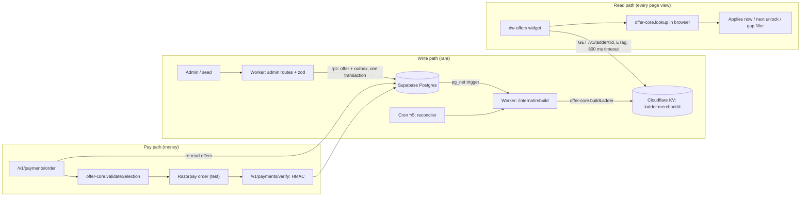

# Discount Whisperer

An offers widget for small Indian D2C stores. It shows which offers apply now, the cheapest next unlock, and a product that fills the gap. The server re-validates every offer with the same rules code before Razorpay (test mode) charges.

> **Read the report here: [report.pdf](report.pdf)** (Markdown version: [report.md](report.md))

**Live API:** `https://dw-api.rishavdewan10.workers.dev` (Cloudflare Worker + Supabase, free tiers, Razorpay test mode).

## The problem

Small online stores run their own offers: "10% off above Rs 1,999", "Rs 250 off on HDFC credit cards", "5% cashback on UPI". Shoppers rarely see them before checkout. So shoppers miss savings, and merchants miss the bigger orders those offers are paid for.

Generic deal-finder extensions don't help here. They see bank-funded offers on big marketplaces, not offers that small stores fund themselves.

A widget for this has to:

- show what applies **now**;
- show the **cheapest next unlock** ("add Rs 199 to save Rs 199.90") and a product that fills the gap;
- handle offers that depend on the **payment method**;
- **never show one amount and charge another**;
- **never break the host page**;
- cost **INR 0** to run.

## Inspiration: Razorpay's Discount Whisperer

The idea comes from Razorpay Engineering's [Behind Closed Doors — Discount Whisperer](https://engineering.razorpay.com/behind-closed-doors-discount-whisperer-4d2331b5747a) (Chetty Arun, Dec 2023). It describes a three-day hackathon build by Razorpay's Affordability team that went to production. What this project took from it:

- **Merchant-funded offers.** Razorpay can show offers that small stores fund themselves, because they run on its Offers Engine. Here, the merchant's own offer table is the source of truth, and each offer records who funds it.
- **The unlock.** Show not only current offers but ones a slightly bigger cart would unlock. That helps shoppers save and businesses raise AOV, so the north-star metric is **AOV uplift**.
- **Offer types.** Instant discount and cashback are in. No-cost EMI is out, because it doesn't fit "you save X". Cashback is shown as a saving but not taken off the charge.
- **Two edge cases from the article.** For payment-instrument offers, method-bound offers are shown as "if you pay with UPI". For two offers with the same discount, there is a fixed tie-break order, pinned in 32 golden test cases.
- **Eligibility checks.** They were deferred in the article and are out of scope here. Every shopper sees the same precomputed ladder.

The article covers the product and the team's process, not Razorpay's internal architecture. The design below is this project's own, shaped by how other teams run promotions in production:

| Engineering blog | Lesson taken | Trade-off made here |
|---|---|---|
| Delivery Hero: promotions execution | Separate rule engines in the promo tool and cart drift apart, so one source and one engine are needed; precompute so promotions start on time | One `offer-core` package; cart-level offers only, no SKU-level |
| redBus: promotions platform | Rules as JSON data, not a DSL; discovery separate from transactions; circuit breakers | Typed offer rows plus a kill switch; no per-user personalisation |
| Airtel: coupon engine | CP store for coupon state, AP store for segments; explicit lock/unlock/availed states | Postgres for pay, KV for display; payment state machine with compare-and-set; no usage caps, so no lock |
| Uber: Tarot (multiple knapsack) | First-in-wins blocks better offers; limit concurrent offers; batch the heavy work | Deterministic ranking; one offer per order, so no solver; no budget pacing yet |
| Shopify: Discount Kit and Functions | Hot-path compute limits; process only the input you need | 10 µs lookup, 9.33 KB widget; three fixed offer kinds instead of arbitrary code |
| Cashfree: offer engine | Min value, max cap, window, payment method, deactivate | Same schema; shown on product and cart pages, before checkout |

Details and the full trade-off table are in [report.md §3.1](report.md#31-prior-art-how-other-teams-built-promotions).

## Architecture

**Big idea:** offers only change at a few cart values. On each edit, precompute a merchant's offers into a small sorted **ladder** in Cloudflare KV. Each page view binary-searches it in the browser (~10 µs). The server is touched only on edits and at payment, and payment always re-reads Postgres.



| Piece | What it does |
|---|---|
| `packages/contracts` | Types, zod schemas, DB names, 32 golden cases. Frozen. |
| `packages/offer-core` | One rules brain shared by the widget, rebuild and checkout: `buildLadder`, `lookup`, `bruteForce`, `savingPaise`, `validateSelection` |
| `packages/widget` | `<dw-offers>` Preact custom element, Shadow DOM, 9.33 KB gzip. Fails closed. |
| `apps/api` | Cloudflare Worker (Hono): ladder, admin, rebuild, validate, Razorpay order/verify, events, metrics, cron |
| `apps/demo` | Static demo store served by the same Worker |
| `supabase` | Migrations (RLS on, no anon policies), outbox trigger, seed, smoke tests |
| `tools`, `docs` | Seed generator (50 merchants), loader, k6, Playwright smoke/memory/drills, runbook |

Money rules: integer paise everywhere, `Math.floor` for percentages, and an offer is live iff `startsAt <= now < endsAt`. See [report.md](report.md) for sequence diagrams, the data model, the payment state machine, trade-offs and test results.

## How to set up

### Local (no cloud accounts)

Needs Node 22+ and pnpm 11.

```bash
pnpm install
pnpm -r typecheck
pnpm -r test
pnpm --filter @dw/api dev:local                 # builds widget; Worker + demo on http://localhost:8787
```

Seed it and run the drills:

```bash
ADMIN_TOKEN=... DW_API=http://localhost:8787 pnpm --filter @dw/tools seed:load
pnpm --filter @dw/tools exec playwright install chromium
DRILL=normal pnpm --filter @dw/tools exec playwright test -c drills/playwright.config.ts
```

Open `http://localhost:8787/?api=mock`. At Rs 1,800 the widget should show "Add a gamcha (Rs 199)".

### Hosted (free tiers)

1. **Secrets file.** Keep secrets in `~/.dw-secrets/prod.env` (`chmod 600`), outside the repo. Never paste them into chat, git or logs.
2. **Supabase.** Create a free project in `ap-south-1`, enable `pg_net`, then apply the migrations and seed:
   ```bash
   for f in supabase/migrations/*.sql; do psql "$SUPABASE_DB_URL" -v ON_ERROR_STOP=1 -f "$f"; done
   ```
3. **KV namespace.** Run `npx wrangler kv namespace create LADDERS` and put the id in `apps/api/wrangler.toml`.
4. **Worker secrets.** Set each one with `printf '%s' "$VALUE" | npx wrangler secret put NAME`. The names are `SUPABASE_URL`, `SUPABASE_SERVICE_ROLE_KEY`, `RAZORPAY_KEY_ID` (must start `rzp_test_`), `RAZORPAY_KEY_SECRET`, `ADMIN_TOKEN` and `REBUILD_HOOK_SECRET`.
5. **Deploy.** Run `pnpm --filter @dw/widget build:demo`, then `cd apps/api && npx wrangler deploy`.
6. **Point the trigger at the Worker.** Write `rebuild_url` (`https://<worker>/internal/rebuild`) and `rebuild_secret` into `app_config`.
7. **Seed and check.** Run `seed:load` with `DW_API=https://<worker>`, `curl /healthz`, then `node supabase/tests/smoke.mjs`.

Details: [docs/runbook.md](docs/runbook.md), [supabase/README.md](supabase/README.md), [apps/api/README.md](apps/api/README.md), [docs/test-payments.md](docs/test-payments.md).

## Known limitations

- **Real test payment not done yet.** The Razorpay checkout modal, its signature and the amount_match check need one manual test payment (checkpoint 3).
- **The cart value is client-claimed.** The server has no catalogue to price the cart, so a client could claim a bigger cart.
- **`razorpay_offer` mode isn't checked after payment.** Verify doesn't fetch the charged amount from Razorpay, so drift between the Razorpay dashboard and the DB is caught only by the amount_match drill.
- **Method-bound instant discounts are hidden until mapped.** They need a Razorpay offer id so Razorpay enforces the payment method. Without one, they're left out of the ladder and the order route returns 409.
- **Cloudflare KV limits.**
  - 1 write/sec per key: 150 of 555 rebuild calls returned 500 during the seed burst. They were retried and drained.
  - 1,000 writes/day on the free plan.
  - Reads are eventually consistent across locations; propagation time hasn't been measured.
- **One offer per order.** Stacked offers are shown as alternatives.
- **`widget_seen_rate` is always null.** There's no `page_view` event.
- **Supabase free projects pause when idle.**
- **Out of scope:** no-cost EMI, per-shopper eligibility, SKU-level offers, merchant dashboard UI, live mode, refunds.

## Plan of action

| Step | Status |
|---|---|
| T0: contracts, golden fixtures, scaffold (checkpoint 1) | done |
| T1–T6: offer-core, API, Supabase, Razorpay, widget/demo, tools, built in parallel | done |
| T7: integrate, local drills, independent money review (6 findings fixed) | done |
| Deploy: Worker, KV, Supabase, pg_net trigger, live checks (checkpoint 2) | done |
| Checkpoint 3: one real Razorpay test payment; run amount_match | **next** |
| Coalesce rebuilds per merchant to stay under KV write limits | planned |
| Map Razorpay test offers so method-bound discounts can show | planned |
| Check the charged amount on verify (Razorpay payment fetch or webhook) | planned |
| Server-side cart pricing (catalogue or signed cart) | planned |
| Add a `page_view` event; measure KV propagation | planned |
| Clean-up: drop the temporary `dw_migrator` role; reset the DB password | planned |
| Later: no-cost EMI messaging, eligibility, merchant UI, CI workflow | backlog |

## References

1. Chetty Arun, [Behind Closed Doors — Discount Whisperer](https://engineering.razorpay.com/behind-closed-doors-discount-whisperer-4d2331b5747a), Razorpay Engineering, Dec 2023. The problem, the unlock idea, offer types and scope.
2. Chris Richardson, [Pattern: Transactional outbox](https://microservices.io/patterns/data/transactional-outbox.html). Offer + outbox in one transaction, with a cron reconciler.
3. Supabase docs: [Row Level Security](https://supabase.com/docs/guides/database/postgres/row-level-security), [pg_net](https://supabase.com/docs/guides/database/extensions/pg_net), [API keys](https://supabase.com/docs/guides/api/api-keys).
4. Cloudflare docs: [How KV works](https://developers.cloudflare.com/kv/concepts/how-kv-works/), [KV limits](https://developers.cloudflare.com/kv/platform/limits/), [Workers limits](https://developers.cloudflare.com/workers/platform/limits/), [Cron Triggers](https://developers.cloudflare.com/workers/configuration/cron-triggers/).
5. Razorpay docs: [Orders API](https://razorpay.com/docs/api/orders/), [Standard Web Checkout](https://razorpay.com/docs/payments/payment-gateway/web-integration/standard/), [Offers](https://razorpay.com/docs/payments/offers/), [test cards](https://razorpay.com/docs/payments/payments/test-card-details/), [test UPI](https://razorpay.com/docs/payments/payments/test-upi-details/).
6. [RFC 9110: HTTP Semantics](https://www.rfc-editor.org/rfc/rfc9110). ETag, If-None-Match, 304.
7. [FNV hash, draft-eastlake-fnv](https://datatracker.ietf.org/doc/draft-eastlake-fnv/). Ladder content hash.
8. Claessen & Hughes, *QuickCheck* (ICFP 2000); [fast-check](https://fast-check.dev/). Property tests against a brute-force reference.
9. MDN: [Custom Elements](https://developer.mozilla.org/en-US/docs/Web/API/Web_components/Using_custom_elements), [IntersectionObserver](https://developer.mozilla.org/en-US/docs/Web/API/Intersection_Observer_API), [sendBeacon](https://developer.mozilla.org/en-US/docs/Web/API/Navigator/sendBeacon).

10. Engineering blogs on promotions systems:
    - [Delivery Hero: promotions execution](https://tech.deliveryhero.com/tackling-key-challenges-in-promotions-execution-how-weve-evolved-our-architecture)
    - [redBus: promotions platform](https://medium.com/redbus-in/a-peek-into-multifaceted-promotions-platform-e3dbd1f26a2f)
    - [Airtel: coupon engine](https://medium.com/airteldigital/coupon-engine-3478bda63968)
    - [Uber: Tarot, multiple knapsack](https://www.uber.com/us/en/blog/solving-multiple-knapsack/)
    - [Shopify: Discount Kit and Functions](https://www.shopify.com/partners/blog/discount-kit-shopify-functions-webassembly-api)
    - [Cashfree: offer engine](https://www.cashfree.com/blog/offer-engine-on-cashfree-checkout-flow/)
11. Razorpay [Offers standard integration](https://razorpay.com/docs/payments/offers/standard-integration/), [custom integration](https://razorpay.com/docs/payments/offers/custom-integration/), [Affordability Widget](https://razorpay.com/docs/payments/payment-gateway/emi%C2%B2/widget/); Cloudflare [cache purge](https://developers.cloudflare.com/cache/how-to/purge-cache/).

How each reference shaped the design is covered in [report.md §13](report.md#13-references-and-how-they-shaped-the-thinking).
