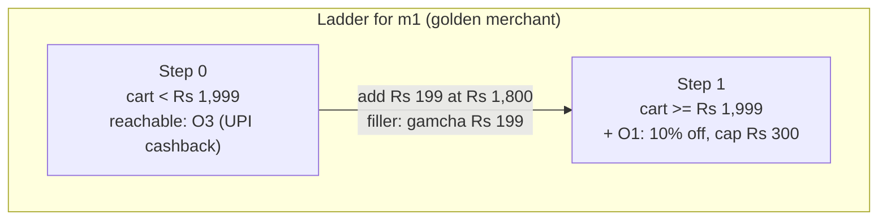
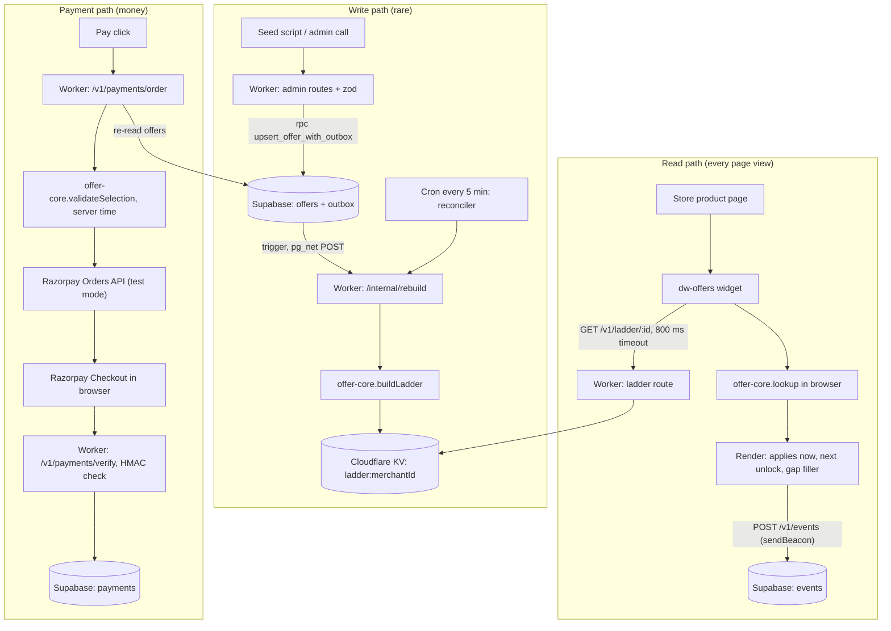
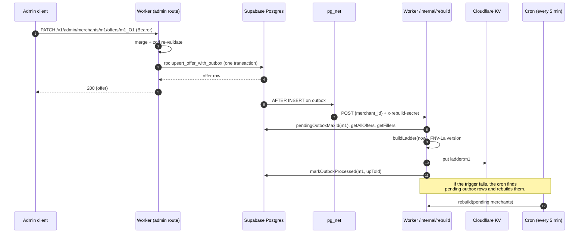
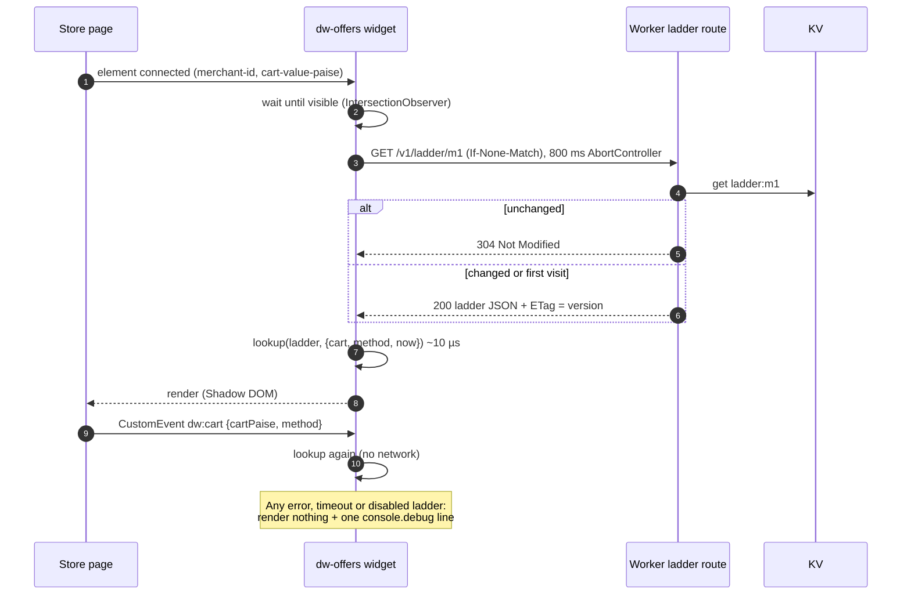
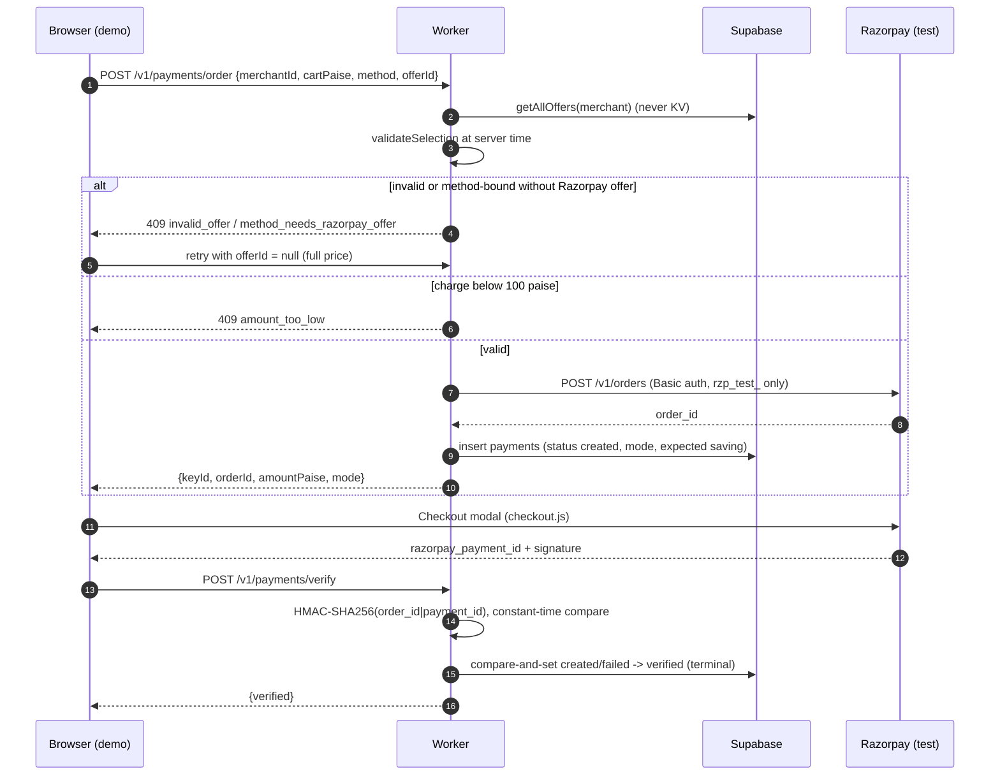
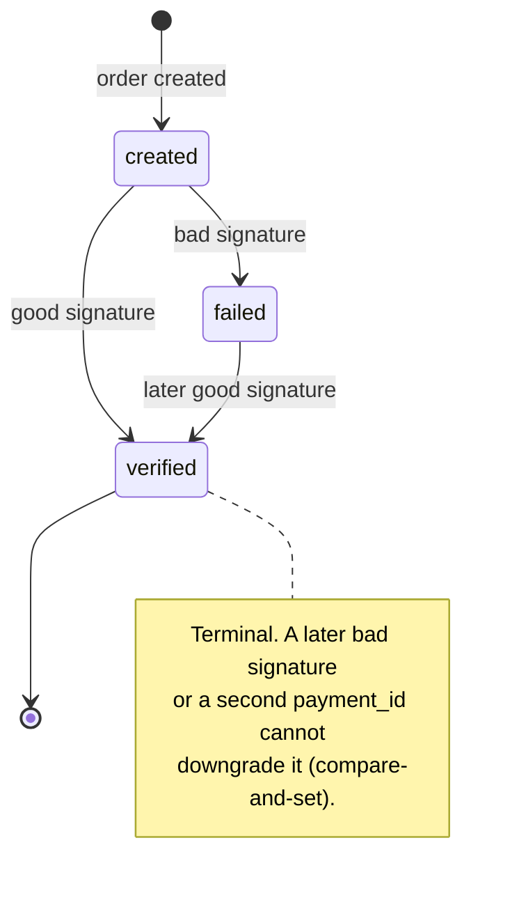
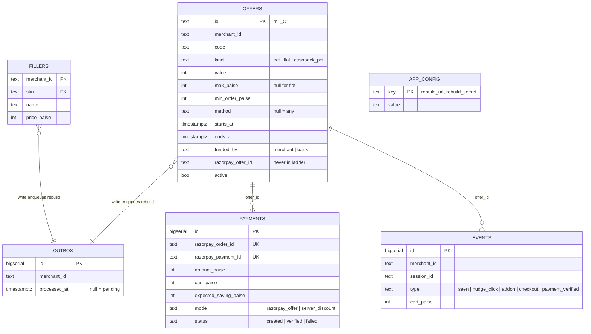
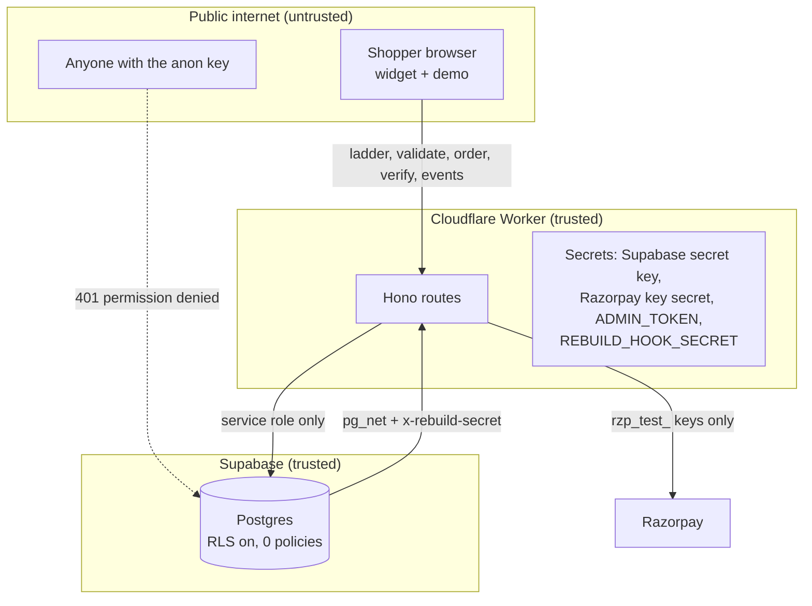
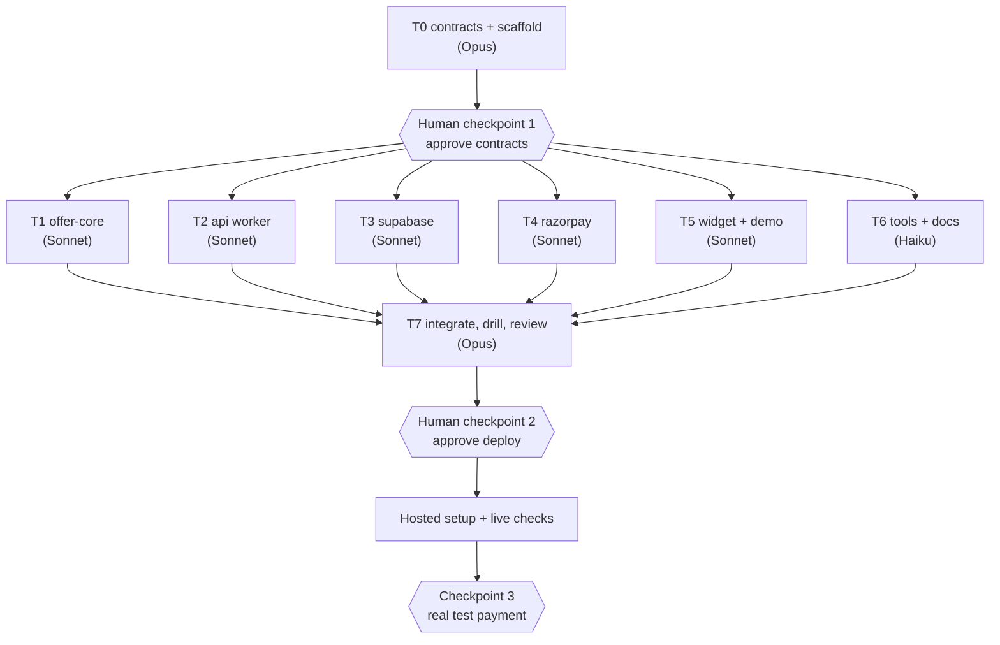

# Discount Whisperer: design report

A rebuild of Razorpay's Discount Whisperer idea as an offers widget for small Indian D2C stores, built in one day with contract-first, multi-agent development on free tiers.

| | |
|---|---|
| Author | Rishav Dewan |
| Date | 14 November 2026 |
| Version | v3.2 (build plan `PLAN.xml`) |
| Status | Built, tested and deployed (Cloudflare Worker + Supabase, Razorpay test mode). One check is still open: a real test payment (checkpoint 3). |
| Live API | `https://dw-api.rishavdewan10.workers.dev` |

---

## Contents

1. Thesis
2. The problem
3. Inspiration: Razorpay's Discount Whisperer
4. The thinking: from idea to design
5. Architecture
6. Rules of the money
7. Why this is a better build
8. How it was built
9. Verification and results
10. Known limitations and open risks
11. How to set up
12. Architecture notes
13. References and how they shaped the thinking

---

## 1. Thesis

**Offers only change at a few cart values. So precompute them once per edit, look them up in the browser on every page view, and check them again on the server only when money moves.**

Three claims follow from that sentence. This report argues for each one.

1. **Fast and cheap reads.** A merchant has a handful of offers, and each offer has one minimum order value. Between two minimums, nothing about the offers changes. So the whole "which offers apply, and what is the next unlock" question reduces to a small sorted file (the *ladder*) and a binary search. The browser can do the search in about 10 µs. The database is never touched on a page view.
2. **Shown = validated = charged, by construction.** The widget, the validator and the order builder all import one rules package (`@dw/offer-core`). The server never trusts the ladder at payment time. It re-reads offers from Postgres and re-runs the same rules before creating the Razorpay order.
3. **Safe to embed.** The widget sits on someone else's store page. On any error, timeout or kill switch it renders nothing, so the merchant's checkout keeps working.

The build process had its own thesis: **freeze the contracts and the golden test cases first, then build in parallel against them.** With six agents working at once, a wrong type is copied six times. Freezing the contracts first stops that.

---

## 2. The problem

Small and mid-size Indian online stores run their own offers: "10% off above Rs 1,999", "Rs 250 off on HDFC credit cards above Rs 2,499", "5% cashback on UPI". Shoppers rarely see these offers until checkout, if at all. Two things are lost:

- **The shopper overpays.** They miss offers they already qualify for, or offers they could unlock with a small top-up.
- **The merchant misses revenue.** A shopper at Rs 1,800 who learns that Rs 199 more unlocks Rs 199.90 off often adds a small item. That raises the average order value (AOV), which is the merchant's main reason to fund an offer.

Generic deal-finder browser extensions don't solve this. They see bank-funded offers on large marketplaces, not the merchant-funded offers that small stores run. A payment gateway that already processes the store's payments, and knows its offers, can show them.

### What a solution must do

| Need | Why it matters |
|---|---|
| Show offers that apply **now** | The shopper sees value straight away |
| Show the **cheapest next unlock** and a product that fills the gap | This is what raises AOV |
| Handle **method-bound** offers ("if you pay with UPI") | Most Indian offers depend on the payment method |
| **Never show a wrong amount** | Showing one price and charging another is a trust and compliance problem |
| **Never break the host page** | The widget is a guest on a merchant's checkout |
| Cost INR 0 to run at demo scale | Free tiers and test mode only |

### Out of scope (on purpose)

- **No-cost EMI.** It doesn't lower the price up front, so it doesn't fit "you save X".
- **Per-shopper rules:** eligibility checks, usage caps and personal offers.
- **SKU-level offers.**
- **A merchant dashboard UI.**
- **Razorpay live mode,** refunds and settlements.

---

## 3. Inspiration: Razorpay's Discount Whisperer

The project starts from Razorpay Engineering's "Behind Closed Doors — Discount Whisperer" (Chetty Arun, December 2023). It describes a three-day hackathon build by Razorpay's Affordability team that later went to production. The points that shaped this project:

| From the article | What this project did with it |
|---|---|
| Small merchants mostly run **merchant-funded** offers, which generic extensions can't see. Razorpay can see them because it runs those merchants' offers. | The source of truth is the merchant's own offer table. Every offer carries a `fundedBy` (merchant or bank) field. |
| The idea that stood out was to show not just current offers but **offers unlocked by a slightly bigger cart**, helping shoppers save and businesses raise AOV. | The widget's core output is the next unlock: `unlockable[]` with the gap in rupees, plus a filler product that covers the gap. The north-star metric is **AOV uplift**. |
| The offer world has **instant discounts, cashback and no-cost EMI**. The team left no-cost EMI out because "you save X" doesn't describe it. | Three offer kinds: `pct`, `flat`, `cashback_pct`. Cashback is shown as savings but **not deducted** from the charged amount. No-cost EMI is out of scope. |
| The team weren't sure whether to show **payment-instrument offers** (for example HDFC credit cards) or only general ones. | Both are shown. Method-bound offers appear as **conditional** ("if you pay with UPI"), and the server enforces the method (see money-review #1). |
| An open edge case: **two offers with the same discount**. Which one do you suggest? | A total, deterministic sort order: saving desc, then id. For unlocks: score desc, gap asc, merchant-funded first, then id. This is pinned in 32 golden test cases. |
| **Eligibility checks** were pushed to the end because they complicated both engineering and design. | Per-shopper eligibility is explicitly out of scope, so every shopper sees the same ladder. That's what makes the ladder cacheable. |
| Ship an MVP fast and push edge cases out. | A 4-hour timebox, a written cut order, and features that are never cut: property tests, server validation, signature checks, fail-closed. |

The article explains the product and the team's process. It doesn't describe Razorpay's internal architecture. Everything in sections 4–8 is this project's own design for the same product idea.

### 3.1 Prior art: how other teams built promotions

The Razorpay article supplied the product idea but not the architecture. For the architecture, I read six engineering write-ups from teams that run offers in production. Each team solved a different part of the problem at a much bigger scale. For each, the notes below cover what they built, what this project took, and the trade-off made where this project chose differently.

**Delivery Hero: promotions execution (Sept 2024).** Delivery Hero's Quick Commerce team serves about 500,000 promotions across vendors with up to 700,000 SKUs each. Their main pain points were consistency problems:

- a shopper sees a promo banner but not the discounted price in the cart;
- the promo tool and the cart service each implement promotions separately ("double development");
- promotions must start on time across many services.

Their fix is a lifecycle of **ingestion → processing → execution**. Processing precomputes everything a promotion needs, so execution needs no "start" event. They are also moving to one unified data source, with L1 in-memory and L2 Redis caches in front of it.

- *Taken:* **one rules package** (D4). `@dw/offer-core` is used by the widget, the rebuild and checkout, so "banner says X, cart charges Y" can't happen by construction. The ladder is this project's **processing stage**: it's precomputed on write and executed cheaply on read. Offer time windows are checked against the clock at lookup (`isLive`) and at payment (`not_started` / `expired`), so no start or stop event is needed.
- *Trade-off:* they federate several services behind a GraphQL supergraph because their data spans product, price and cart domains. This project has one domain (cart-level offers), so one Worker and one package is enough. SKU-level offers, the dimension that drives their row counts, are out of scope here.

**redBus: a multifaceted promotions platform (Feb 2022).** redBus splits its promotions world into:

- **offer discovery**, which is high-traffic and served in about 10 ms on average;
- **transactions and rewards**, such as bookings and referrals;
- a **configuration tool**.

They replaced a custom DSL rule engine with **JSON rules evaluated by JS close to the data**. The DSL meant loading every rule into memory, parsing and compiling it, and a steep learning curve. JSON rules are easier to extend, and they support differential (per-user) discounts. Their gamification engine also has **circuit breakers** for out-of-bound spend.

- *Taken:* **rules are data, not a DSL.** An offer is a typed row (`kind`, `value`, `minPaise`, `maxPaise`, `method`, window), validated by zod and evaluated by plain TypeScript that a brute-force reference can check. Discovery and transaction are **separate paths** with different guarantees: the read path is cached and fast, the pay path is authoritative. The kill switch (`disabled: true` in the ladder) is a simple circuit breaker.
- *Trade-off:* redBus evaluates per user so it can personalise discounts. This project gives up personalisation so every shopper gets the same cacheable answer. A spend-based circuit breaker (stop an offer once it has cost Rs X) isn't built.

**Airtel Digital: coupon engine (May 2018).** Airtel **locks** a coupon when a transaction starts, **unlocks** it on failure, and marks it **availed** on success. A pending transaction keeps it blocked until a final status arrives. They deliberately split storage by consistency need:

- **MongoDB (CP)** for coupon state and user coupon history, where it must be correct;
- **Aerospike (AP)** for 400 million users' segments, where an occasional stale read is acceptable.

- *Taken:* the same **CP for money, AP for display** split. Payments and offers live in Postgres, and the payment path always re-reads it. The ladder lives in eventually consistent KV, where staleness only affects what's shown. Airtel's explicit coupon states inspired the **payment state machine** (created → verified / failed; failed → verified; verified is terminal), enforced with compare-and-set (money-review #2).
- *Trade-off:* this project has no per-offer usage caps, so nothing needs reserving and there's no lock step. If "first 100 orders only" offers are added, Airtel's reserve, then commit or release, flow becomes necessary.

**Uber: Tarot, incentives as a multiple-knapsack problem (May 2026).** Uber treats incentive allocation as an NP-hard optimisation:

- the items are treatments, the weights are their costs, the values are predicted uplift, and the knapsacks are team budgets;
- it's solved in cron-scheduled batches with a **budget pacer** (a feedback loop on actual spend) and a CP-SAT solver;
- the system it replaced resolved conflicts **first-in-wins**, so early offers blocked better ones;
- Uber also **limits concurrent offers** to avoid clutter.

- *Taken:* **never first-in-wins.** The ranking is total and deterministic: saving desc, then id; for unlocks, score desc, gap asc, merchant-funded first, then id. It's pinned in golden tests. **Limit what's shown:** one applied offer, the rest as "or", and one next unlock (money-review #4). **Do heavy work in batch and serve cheap.**
- *Trade-off:* Tarot optimises the platform's ROI under budgets using ML predictions. This project picks the best saving *for the shopper*, with **one offer per order**. That removes the combinatorial stacking problem completely, so lookup stays a binary search instead of a solver. There is no budget pacing, so merchant spend is uncapped. That's listed as future work.

**Shopify: Discount Kit and Shopify Functions (July 2025).** Discount logic in Shopify runs *inside checkout*, under strict instruction limits. Moving Discount Kit to the WebAssembly API, which only deserialises the input fields the code actually reads, gave these results:

- about 30% fewer instructions (610k → 430k at p75);
- a 40% smaller binary (249 KB → 156 KB);
- nearly eliminated limit errors.

The Discount API also lets one code apply product, order and shipping effects, with up to 25 discount functions running at once.

- *Taken:* **treat the hot path as a hard budget.** The Worker has 10 ms of CPU per request on the free plan. Lookup takes about 10 µs. The widget is 9.33 KB gzip against a 15 KB budget and fails closed on timeout. The ladder's precomputed `mins[]` means a lookup touches only what it needs, which is the same "don't process unused input" lesson.
- *Trade-off:* Shopify lets merchants run arbitrary discount code, which is maximally flexible. This project supports three fixed offer kinds (`pct`, `flat`, `cashback_pct`). That's less flexible, but every result can be checked against a brute-force reference and 32 golden cases.

**Cashfree: offer engine on checkout (Jan 2023).** Cashfree lets merchants configure offers on payment modes (cards, net banking, wallets, UPI, EMI), with these features:

- guardrails: maximum discount, minimum transaction value, duration;
- flat or percentage, discount or cashback;
- deactivate at any time;
- filters such as per-customer or per-card limits and BIN lists;
- customers see all valid offers with the **effective price**.

- *Taken:* the offer schema follows this vocabulary almost one to one: `minPaise`, a `maxPaise` cap, a `startsAt`/`endsAt` window, `method`, discount vs cashback, plus `active` and the kill switch for deactivation. The widget shows the effective saving in rupees.
- *Trade-off:* Cashfree shows offers **on the checkout page**, after the shopper has committed to a cart. This widget shows them **on the product and cart page**, earlier, which is where an unlock can still change the cart size and raise AOV. BIN lists and per-card limits aren't supported. Method enforcement is delegated to Razorpay Offers instead (money-review #1).

**Summary of the trade-offs**

| Question | What large platforms do | What this project does | Why, at this scale |
|---|---|---|---|
| Where are rules evaluated? | Per request, often per user (redBus, Shopify) | Precomputed per merchant, looked up in the browser | Same answer for every shopper, so it's cacheable at the edge for INR 0 |
| How many rule engines? | Often several, which then drift (Delivery Hero's "double development") | One package, used in three places, tested against brute force | Display = validate = charge is the first priority |
| Consistency | CP for money, AP for reach (Airtel) | Postgres for pay, KV for display | Staleness can only affect what's shown, never what's charged |
| Picking offers | Optimiser under budgets (Uber) | Deterministic best saving, one per order | No stacking means no knapsack; ranking is pinned by golden tests |
| Rule flexibility | DSL, JSON rules or merchant code | Three typed offer kinds | Verifiable end to end; enough for small D2C stores |
| Where the offer appears | Checkout page (Cashfree, Razorpay checkout) | Product and cart page | An unlock only helps before the cart is final |
| Personalisation and eligibility | Segments, per-user rules (Airtel, redBus, Uber) | None | Kept out on purpose, the same deferral the Razorpay article made; segment ladders are the path (see 7.2) |

**Infrastructure docs that settled specific decisions.**

- **Razorpay Offers (standard and custom integration):** these are what make `razorpay_offer` mode possible. Razorpay enforces the payment method, so method-bound discounts go through it (D5, money-review #1).
- **Razorpay's Affordability Widget docs:** treat eligibility as a separate check, which supports deferring it.
- **Cloudflare cache purge docs** (purge is now available on all plans): these made R2 + CDN + purge a real alternative for D3. KV won because rebuilds write one key and need no purge call or purge-rate limits.
- **Workers and KV limits:** set the budgets and named the risks listed in section 10.

---

## 4. The thinking: from idea to design

### 4.1 The key observation

Take one merchant with offers O1..On. Each offer has a minimum order value. Sort the minimums: `m1 <= m2 <= ... <= mn`. For any cart value between two neighbouring minimums, the set of reachable offers is the same. Only the saving amount changes, and that is a pure function of the cart.

So the answer for any cart has two parts:

1. Find the **step**: how many minimums are at or below the cart. Binary search does this in O(log n).
2. Compute savings for that step's offers and rank the next few unlocks above it.

That is the **ladder**: offers sorted by minimum, plus a parallel `mins[]` array for the binary search, plus fillers sorted by price. It is small (m1 is 738 bytes; a 250-offer stress merchant is 33.6 KB). It is the same for every shopper. And it only changes when the merchant edits something.



### 4.2 Consequences of the observation

| If the answer only changes on edits... | ...then |
|---|---|
| Compute it on **write**, not on read | The server does work only when a merchant edits, which is rare |
| Store it **at the edge** | Page views read a file close to the shopper, not a database in Mumbai |
| Run lookup **in the browser** | No server CPU per page view, and the widget keeps working on a cached ladder |
| Give it a **content hash** | ETag = version, so a repeat visit costs a 304 with no body |
| Every shopper sees the same ladder | Per-shopper eligibility has to be out of scope, which it is |

### 4.3 The danger, and how it's handled

Precomputed data goes stale. A stale ladder can show an offer that has just been edited or ended. Precomputing is only safe if **staleness can never become a wrong charge**:

- **Payment never reads the ladder.** `/v1/payments/order` re-reads offers from Postgres and runs `validateSelection` at server time.
- **The ladder only ever under-promises.** Offers that ended before `builtAt` are dropped. An unlock's saving is computed at exactly its minimum, so a percent offer can only turn out slightly better than shown. And if a browser clock runs behind, the widget shows fewer offers, never wrong money.
- **Changes can't be lost.** Each offer write and its outbox row are one transaction. A pg_net trigger rebuilds in about a second. A 5-minute cron picks up anything the trigger missed.

### 4.4 Design decisions and trade-offs

| # | Choice | Why | Cost | Alternative considered |
|---|---|---|---|---|
| D1 | Supabase Postgres as the source of truth, reached over HTTPS (PostgREST/RPC) | Real transactions in RPC functions, a SQL editor, pg_net for the change trigger. supabase-js runs in Workers without a TCP driver. | Every write is an HTTPS hop from Cloudflare to Mumbai. Fine, because writes are rare. | Cloudflare Hyperdrive plus a Postgres driver: more setup, and no benefit at this write volume |
| D2 | Outbox table + pg_net trigger + 5-minute cron reconciler, instead of a queue | The outbox row lands in the same transaction as the offer, so a change is never lost. The trigger is fast; the cron is the safety net. | If both the trigger and the first cron fail, the ladder can be up to 5 minutes stale. Checkout re-validates, so money stays right. | A message queue: another service, and nothing gained here |
| D3 | Cloudflare KV for ladders | One-line read from the Worker, replicated to the edge, no custom domain needed | Eventually consistent; 1 write/sec per key; 1,000 writes/day on the free plan | R2 + purge-by-URL: needs a custom-domain zone |
| D4 | One TypeScript rules package for builder, validator and widget | Shown = validated by construction | The server is tied to JS/TS | Rust compiled to WebAssembly, if checkout ever has to run elsewhere |
| D5 | Two Razorpay modes: `razorpay_offer` when an offer is mapped to a Razorpay offer id, `server_discount` otherwise | Keeps the demo working when test-mode offer setup is unreliable | Offer rules are duplicated in the Razorpay dashboard. Drift is caught by the amount_match drill. | Razorpay offers only |
| D6 | Events in Supabase, not PostHog | No extra signup; the metrics RPC proves the metric tree | No funnel UI | PostHog behind the same `/v1/events` contract later |
| D7 | Integer paise everywhere, `Math.floor` for percentages | Floats lose paise, and Razorpay amounts are in paise | Formatting in the UI | — |
| D8 | Six parallel builder worktrees after the contracts | The 4-hour timebox only works in parallel | One human supervising six sessions is the bottleneck | Sequential build |

### 4.5 A decision changed by review: method-bound discounts

An independent review of the money paths found that `server_discount` mode **trusted the payment method sent by the client**. A shopper could claim `HDFC_CC`, get the Rs 250 bank discount baked into the order amount, then pay with UPI. The signature still verifies, because Razorpay signs the order and payment ids, not the method.

The fix chosen was **Razorpay-only for method-bound instant discounts**. Such an offer needs a mapped `razorpay_offer_id`, so that Razorpay itself enforces the method at checkout. Without one, the order route returns `409 method_needs_razorpay_offer`, and the rebuild leaves the offer out of the ladder so it is never shown. Method-bound *cashback* stays allowed, because nothing is deducted at payment.

Lesson: "same rules code on both sides" is necessary but not enough. **Any input the client claims (method, cart value) is untrusted** unless a third party enforces it.

---

## 5. Architecture

### 5.1 System overview



### 5.2 Components

| Component | Role | Technology |
|---|---|---|
| `@dw/contracts` | Types, zod schemas, DB names, 32 golden cases. Frozen after checkpoint 1. | TypeScript, zod 4 (server only) |
| `@dw/offer-core` | The single rules brain: `buildLadder`, `lookup`, `bruteForce`, `savingPaise`, `validateSelection`. No runtime dependencies; runs in browsers and Workers. | TypeScript |
| `apps/api` | Admin, ladder, internal rebuild, checkout validate, payments, events, metrics, cron reconciler | Cloudflare Worker, Hono |
| Supabase Postgres | Source of truth: `offers`, `fillers`, `outbox`, `events`, `payments`, `app_config`. RLS on, no anon policies. | Postgres 17, pg_net |
| Cloudflare KV | `ladder:{merchantId}` at the edge | Workers KV |
| `@dw/widget` | `<dw-offers>` custom element, Shadow DOM, 9.33 KB gzip | Preact, Vite |
| `apps/demo` | Static demo store served by the same Worker | HTML/JS, Razorpay Checkout |
| `tools` | Seed generator (50 merchants), admin loader, k6 load tests, Playwright smoke/memory/drills | faker, k6, Playwright |

### 5.3 Write path: edit to new ladder



The **outbox protocol** reads `pendingOutboxMaxId` *before* building, and only marks rows up to that id as processed. An edit that lands in the middle of a rebuild keeps its pending row and triggers another rebuild. Nothing is silently dropped.

### 5.4 Read path: page view



### 5.5 Pay path: money



### 5.6 Payment state machine



### 5.7 Data model



### 5.8 Security boundaries



---

## 6. Rules of the money

| Rule | Detail |
|---|---|
| Units | Integer paise everywhere. Rs 1,999 = `199900`. No floats. |
| Live window | `startsAt <= now < endsAt` (end is exclusive) |
| Saving | `pct`, `cashback_pct`: `floor(cart * value / 100)`, capped at `maxPaise`. `flat`: `min(value, cart)`. |
| Charge | `cart - saving` for `pct` and `flat`. **`cart` for `cashback_pct`** (paid back later, not deducted). |
| Step | Number of live offers with `min <= cart`, whatever their method |
| Applicable vs conditional | `min <= cart` and method matches (or is null) → applicable. Offer needs a method but the shopper hasn't picked one → conditional. Otherwise dropped. |
| Unlock ranking | `score = saving at min / gap`, then gap asc, merchant-funded first, id asc. Top 3. |
| Filler | Cheapest product (then sku asc) with price >= the top unlock's gap |
| Validate check order | `unknown_offer`, `inactive`, `not_started`, `expired`, `below_min`, `method_mismatch` |
| Minimum charge | Below 100 paise → `409 amount_too_low` |
| Invariant (property-tested) | `lookup(buildLadder(offers, t0), x)` deep-equals `bruteForce(offers, x)` for all `x.now >= t0`. Every applicable offer passes `validateSelection` with the same saving. |

**Worked example (golden case 1).** m1 at Rs 1,800, no method picked:

- **Applies now:** nothing.
- **Conditional:** O3, 5% UPI cashback = Rs 90.
- **Next unlock:** O1 (10% off) needs Rs 199 more. Its saving at the minimum is `floor(199900 × 10 / 100)` = Rs 199.90.
- **Filler:** the cheapest product covering a Rs 199 gap is the gamcha at Rs 199.
- **Widget shows:** "Add a gamcha (Rs 199)".

---

## 7. Why this is a better build

### 7.1 Compared with the obvious design

The obvious design: the widget calls an API on every page view, and the API queries the offers table and computes the answer.

| Concern | Obvious design (API per view) | This design (precomputed ladder) |
|---|---|---|
| Database load | One query per page view | Zero per page view. Only edits and payments touch Postgres. |
| Latency | Shopper → edge → Mumbai DB → back | Edge KV read, often a 304; lookup ~10 µs in the browser |
| Cart changes | Another round trip per quantity change | `dw:cart` event re-runs lookup locally, no network |
| Free-tier fit | Page views eat DB and Worker CPU | Reads are tiny KV gets; k6 at 10 VUs: 0% failed, p95 20 ms |
| Wrong money | Depends on keeping two code paths in sync | One rules package; the server re-validates from the DB before every charge |
| Host page safety | An API outage can block rendering | 800 ms timeout, fails closed, no throw into the host page |
| Staleness | None | Bounded and harmless: trigger (~1 s), cron (5 min), and payment never reads the ladder |

### 7.2 At scale

The numbers in 7.1 come from a 50-merchant demo. The real question is what happens at platform scale. The figures below are a back-of-envelope model, not measurements. The assumptions are stated so they can be challenged.

**Assumed load** (a payment-gateway-sized rollout):

| Input | Assumption | Derived rate |
|---|---|---|
| Merchants on the widget | 10,000 | — |
| Widget views | 1 billion / month | ~385/s average, **~4,000/s peak** (10× on sale days) |
| Cart changes per view | 2 | another ~8,000/s at peak in the obvious design |
| Offer edits | 50 / merchant / day | 500,000/day, ~6/s |
| Payments | 2% of views | ~20 M/month, **~80/s peak** |

**The core scaling property.** In this design, database load scales with **edits + payments**, not with **traffic**. Page views and cart changes never reach Postgres.

| Peak load | Obvious design (API per view) | This design |
|---|---|---|
| Postgres reads/s | ~12,000 (views + cart changes) | ~80 payments × a few queries + ~6 rebuild reads ≈ **a few hundred** |
| Ratio | 1× | **~40–50× less** database work |
| Read path | Every request crosses to one region (Mumbai) | Served by Cloudflare's edge nearest the shopper; repeat views are 304s with no body |
| Cart changes | One round trip each | Zero network: `lookup` re-runs in the browser |
| Hot merchant on a sale day | Its traffic hits the shared DB | Its traffic hits KV/edge only; other merchants are unaffected |
| Bandwidth | JSON answer per request | ~1 KB ladder once per version per browser, then 304s |

Read cost becomes **O(1) per view** (one cached key fetch plus an O(log n) binary search in the browser). Write cost is **O(n log n) per edit, per merchant**, where n is that merchant's offer count. Under these assumptions views outnumber edits about 65 to 1 (about 200 to 1 counting cart changes), and each edit is paid once while each view is free, so this is the right trade: the work is done where it's rare.

Correctness doesn't degrade with scale either. The payment path always re-reads Postgres and runs `validateSelection`. So more merchants, more edits and more cache locations can make the *display* briefly stale, but never make the *charge* wrong.

**Where this design hits limits at scale, and the fix for each:**

| Limit | When it bites | Fix |
|---|---|---|
| Free plans (100k Worker requests/day, 100k KV reads/day, 1k KV writes/day) | Almost immediately | Paid Workers/KV plans. Read cost is then a per-million-requests price instead of database capacity. Add the Cache API or `Cache-Control` in front of KV to cut KV reads further. |
| KV allows 1 write/sec per key | Bulk edits to one merchant. Already seen: 150 of 555 rebuilds failed in the seed burst. | Coalesce rebuilds per merchant: debounce in the outbox, one rebuild per merchant per window. This is planned. |
| pg_net fires once per edit | 6/s is fine; a bulk import of 10k offers is not | Same coalescing. The cron reconciler already batches. |
| Very large merchants (thousands of offers) | The ladder grows linearly: 250 offers is 33.6 KB | Keep only the best offer per breakpoint, split ladders by payment method, or cap the unlocks shown. The widget only ever shows "now" plus "next". |
| KV is eventually consistent across locations | Shoppers far from the write may see the old ladder for a while | Harmless for money (payment re-reads the DB). The ETag version tells the shopper's browser when it changes. Propagation time still needs measuring. |
| The payment path is one Postgres | ~80/s is easy for one instance. Much higher needs care. | Connection pooling (Supavisor), a read replica for the offer re-read, and partitioning `payments` by time |
| Per-shopper eligibility | Precompute stops working if every shopper has a different answer | Precompute per *segment* (e.g. new vs returning, card BIN group), a handful of ladders per merchant, never per shopper |

**Why the obvious design is worse at scale, not just slower.** Its database load grows with traffic, and traffic is spiky (sales, festivals, influencer posts). So you must provision the database for peak shopper traffic across *all* merchants at once, and one merchant's sale can slow everyone's checkout. This design separates the two: the edge absorbs traffic spikes, and the database is sized for edits and payments, which grow far more slowly and predictably.

### 7.3 Compared with a browser extension

- **Coverage.** An extension only sees offers that are public. This design runs on the merchant's own data, including merchant-funded offers.
- **Reach.** Every shopper sees it, not only those who installed something.
- **Correctness.** The same rules decide what's shown and what's charged.

### 7.4 Why the build process is better

| Practice | Effect seen in this build |
|---|---|
| **Contract-first, frozen** (`@dw/contracts`, golden.json) | Six agents built in parallel, then merged in order with no interface rewrites |
| **Golden fixtures, recomputed independently** | A fresh reviewer recomputed 26 cases by hand. All agreed, and 6 more cases were added for gaps it found. |
| **Brute-force reference + property tests** | `lookup == bruteForce` over 10,000 runs on 4+ seeds. Mutating the binary search made 4 tests fail, so the tests can actually catch bugs. |
| **Golden-three-ways test** | The same cases agree across offer-core, the validate route and the order route |
| **Disjoint file ownership** (G1/G2) | No merge conflicts in owned code; cross-task needs went through "Requests" |
| **Model per task** | Opus for contracts, integration and review. Sonnet for scoped builds. Haiku for grunt work. |
| **Failure drills, not just tests** | api_down, slow_api, trigger_down, stale_money, bad_signature and kill_switch, each run against a real Worker |
| **Independent money review** | Found 6 real issues (2 high), each confirmed by a failing test before it was fixed |
| **INR 0** | Cloudflare free plan, Supabase free plan, Razorpay test mode |

---

## 8. How it was built

### 8.1 Build DAG



Merge order: T1, T3, T2, T4, T5, T6. Each task had a scope, a loop limit, acceptance checks and a report (`reports/T0.md` … `T6.md`).

### 8.2 Guardrails that every agent followed

- **G1:** Edit only files in your scope. Anything else goes under "Requests".
- **G2:** Contracts, `index.ts` and `env.ts` are frozen.
- **G3:** No secrets in git, prompts, logs or reports.
- **G5:** RLS on every table, no anon or authenticated policies, and the service-role key only inside the Worker.
- **G6:** Razorpay `rzp_test_` keys only, and always verify the signature on the server.
- **G7:** No paid features.
- **G10:** Never weaken another task's tests.
- **When stuck:** after 3 failed fixes, stop and report.

### 8.3 Cut order if late

1. The k6 run (keep the scripts).
2. The metrics endpoint.
3. The pg_net trigger (keep the cron and admin rebuild).
4. Conditional offers in the UI (keep them in the core).

**Never cut:** property tests, server validation, signature verification, widget fail-closed. In the end nothing was cut.

---

## 9. Verification and results

### 9.1 Tests

| Package | Result |
|---|---|
| contracts | golden.json structural check, 32 cases |
| offer-core | 62 pass (golden, 5 fast-check properties on 4+ seeds) |
| api | 102 pass (routes, payments, golden-three-ways, review regressions) |
| widget | 46 pass |
| tools | 3 pass (m1 seed equals golden) |

### 9.2 Numbers

| Metric | Value | Budget |
|---|---|---|
| m1 ladder | 738 B | < 1 KB |
| m50 ladder (250 offers) | 33.6 KB | — |
| Widget bundle | 9.33 KB gzip | ≤ 15 KB |
| lookup, 250 offers (Node) | ~9.5 µs median | < 50 µs |
| Edit → new ladder (admin path, local) | 82 ms | — |
| Edit → new ladder (pg_net path, hosted) | < 1 s | — |
| k6 ladder, 10 VUs 30 s (local) | 2,706 req, 0% failed, p95 20 ms | < 1% failed |
| k6 validate, 10 VUs 30 s (local) | 2,724 req, 0% failed, p95 24 ms | < 1% failed |
| Widget heap, 100 mount/unmount | 15 KB total | no steady growth |

### 9.3 Drills

| Drill | Result |
|---|---|
| api_down | pass: the widget renders nothing; cart and Pay still work |
| slow_api (2 s ladder) | pass: aborted at ~913 ms; the page still works |
| trigger_rebuild | pass: local 82 ms; hosted pg_net < 1 s |
| stale_money | pass: validate reads Postgres, not KV → `below_min`, order 409 |
| trigger_down | pass: one cron run processed the pending outbox row |
| bad_signature | pass: `verified:false`; a repeat verify doesn't double-count |
| kill_switch | pass: `disabled:true` → nothing rendered |
| memory | pass |
| amount_match | **not run**: needs a real Razorpay test payment (checkpoint 3) |

### 9.4 Hosted checks (13 November 2026)

- **Database:** 6 tables, RLS on all, 0 policies. 5 RPC functions owned by `postgres`, and only `service_role` can execute them.
- **Anon key:** gets 401 on every table and on RPC.
- **Seed:** m1..m50 loaded, 0 failed.
- **Endpoints:** `/healthz` 200. Ladder 200 + ETag; a repeat request with that ETag gets 304.
- **Money:** validate and order agree. The order is 224910 paise in `server_discount` mode, with a `rzp_test_` key.
- **Rejections:** below min → 409. The HDFC_CC offer with no Razorpay offer id → 409 `method_needs_razorpay_offer`, and it's left out of the ladder.
- **Trigger:** an admin PATCH → pg_net → new ladder version in under 1 s. Outbox: 0 pending.
- **Drills (`DRILL=normal`) against the deployed URL:** pass. Retries were needed because the test machine's network resets about 20–40% of connections to `*.workers.dev`; an independent check from Supabase's network returned 200 every time.

### 9.5 Money review findings

| # | Sev | Finding | Status |
|---|---|---|---|
| 1 | high | `server_discount` trusted the method sent by the client | Fixed: method-bound instant discounts go through Razorpay offers only |
| 2 | high | A verify race could downgrade verified → failed, or add a second payment_id | Fixed: compare-and-set; `verified` is terminal |
| 3 | med | The demo picked an offer the server rejects, with no fallback | Fixed: pick the best payable offer, retry once with no offer |
| 4 | med | The widget showed every applicable offer as "applied" | Fixed: the best one is applied, the rest are shown as "or" |
| 5 | low | A cashback offer with a Razorpay id would have gone to Razorpay as an instant discount | Fixed: cashback is always `server_discount` |
| 6 | low | The widget's ladder cache never expires and uses the browser clock | Accepted: the server re-validates |

---

## 10. Known limitations and open risks

| Area | Limitation | Impact | Mitigation / next step |
|---|---|---|---|
| Payment | Real test payment (checkout modal, signature from Razorpay, amount_match) not run | The last link of shown = charged isn't proven end to end | Checkpoint 3: one manual test-mode payment |
| Cart value | The server never prices the cart; `cartPaise` is whatever the client claims | A client can claim a bigger cart to unlock an offer | Needs a catalogue or a signed cart from the merchant (v3.1 note) |
| razorpay_offer mode | Verify doesn't fetch the charged amount from Razorpay | Drift between the dashboard offer and the DB offer goes unseen | Razorpay webhook or payment fetch on verify |
| KV writes | 1 write/sec per key, and 1,000 writes/day on the free plan | 150 of 555 pg_net rebuild calls returned 500 during the seed burst (they were retried and drained) | Coalesce rebuilds per merchant (debounce), or batch the seed |
| KV consistency | Eventually consistent across locations; propagation time not measured | Some regions can see an older ladder for up to about 60 s | Harmless for money; measure it |
| Method-bound discounts | They need a Razorpay offer id, else they're hidden | No HDFC-style offers until they're mapped in the dashboard | Map Razorpay test offers |
| Stacking | Only one offer is applied per order | Stacked offers (O1 + O2) are shown as alternatives | A product decision |
| Metrics | `widget_seen_rate` is always null (no `page_view` event) | One ratio missing | Add a `page_view` event |
| Free tier | Supabase free projects pause when idle | The demo can be down after a quiet week | Restore from the dashboard before a demo |
| Ops leftovers | Temporary role `dw_migrator` (NOLOGIN) still exists; the `postgres` DB password was never captured | Tidiness | Drop the role and reset the password in the dashboard |
| Test drift | `smoke.mjs` outbox-count asserts fail on hosted because the live trigger drains the outbox mid-test | A false failure | Pause the trigger during the smoke run, or relax the assert |
| Scope | No no-cost EMI, per-shopper eligibility, SKU offers or merchant UI | — | Roadmap |

---

## 11. How to set up

### 11.1 Prerequisites

- Node 22+ and pnpm 11 (`packageManager` pins 11.8.0)
- Optional: k6, Postgres 17 (for the local DB), Playwright Chromium
- Accounts, all free: Cloudflare, Supabase, Razorpay (test mode)

### 11.2 Local (no cloud accounts needed)

```bash
pnpm install
pnpm -r typecheck
pnpm -r test
pnpm --filter @dw/widget build:demo        # build widget, size-check, copy into demo
pnpm --filter @dw/api dev:local            # Worker + demo on http://localhost:8787 (in-memory repo, fake Razorpay)
```

Seed and drill against it:

```bash
ADMIN_TOKEN=... DW_API=http://localhost:8787 pnpm --filter @dw/tools seed:load
pnpm --filter @dw/tools exec playwright install chromium
DRILL=normal pnpm --filter @dw/tools exec playwright test -c drills/playwright.config.ts
k6 run tools/k6/ladder.js
```

Open `http://localhost:8787/?api=mock` to see the widget with the mock ladder. At Rs 1,800 it should show the gamcha nudge.

### 11.3 Hosted

1. **Secrets file outside the repo.** Create `~/.dw-secrets/prod.env` with `chmod 600`, holding `ADMIN_TOKEN` and `REBUILD_HOOK_SECRET` (random, 32+ characters), `RAZORPAY_KEY_ID` (`rzp_test_…`), `RAZORPAY_KEY_SECRET`, `SUPABASE_URL` and `SUPABASE_SERVICE_ROLE_KEY`. Never paste these into chat, git or logs.
2. **Supabase.** Create a free project in `ap-south-1` and enable `pg_net`. Then apply the migrations and seed:
   ```bash
   for f in supabase/migrations/*.sql; do psql "$SUPABASE_DB_URL" -v ON_ERROR_STOP=1 -f "$f"; done
   psql "$SUPABASE_DB_URL" -v ON_ERROR_STOP=1 -f supabase/seed.sql
   ```
3. **Cloudflare KV.** Create the namespace and put its id in `apps/api/wrangler.toml` (`LADDERS` binding):
   ```bash
   cd apps/api && npx wrangler kv namespace create LADDERS
   ```
4. **Worker secrets.** For each of `SUPABASE_URL`, `SUPABASE_SERVICE_ROLE_KEY`, `RAZORPAY_KEY_ID`, `RAZORPAY_KEY_SECRET`, `ADMIN_TOKEN` and `REBUILD_HOOK_SECRET`, pipe the value in from the env file, never echo it:
   ```bash
   printf '%s' "$VALUE" | npx wrangler secret put NAME
   ```
5. **Deploy.**
   ```bash
   pnpm --filter @dw/widget build:demo && cd apps/api && npx wrangler deploy
   ```
6. **Point the trigger at the Worker** (SQL, run once). Replace `<worker>` and `<REBUILD_HOOK_SECRET>`:
   ```sql
   insert into app_config(key, value) values
     ('rebuild_url', 'https://<worker>/internal/rebuild'),
     ('rebuild_secret', '<REBUILD_HOOK_SECRET>')
   on conflict (key) do update set value = excluded.value;
   ```
7. **Seed and check.**
   ```bash
   DW_API=https://<worker> ADMIN_TOKEN=... pnpm --filter @dw/tools seed:load
   curl -s https://<worker>/healthz
   SUPABASE_URL=... SUPABASE_SERVICE_ROLE_KEY=... SUPABASE_ANON_KEY=... node supabase/tests/smoke.mjs
   ```
8. **Test payment.** Open the demo, pick a method, Pay, and use the card or UPI details from Razorpay's test pages (`docs/test-payments.md`).

---

## 12. Architecture notes

### 12.1 Repository layout

```
packages/contracts   types, zod schemas, DB names, golden fixtures (frozen)
packages/offer-core  buildLadder, lookup, bruteForce, savingPaise, validateSelection
packages/widget      <dw-offers> Preact custom element
apps/api             Cloudflare Worker (Hono): routes, repos, rebuild, reconciler, razorpay/
apps/demo            static demo store (served by the Worker's static assets)
supabase             migrations 0001-0004, seed, smoke tests
tools                seed generator + loader, k6, Playwright smoke/memory/drills
docs                 runbook, metrics, test payments
reports              per-task reports T0-T6; REPORT-FINAL.md is the integration report
```

### 12.2 API surface

| Method | Path | Auth | Purpose |
|---|---|---|---|
| GET | `/healthz` | — | `{ok, version}` |
| GET | `/v1/ladder/:merchantId` | — | Ladder JSON, ETag = version, `max-age=60`, CORS any origin |
| POST/PATCH/DELETE | `/v1/admin/merchants/:id/offers[/:offerId]` | Bearer | Write offer + outbox in one RPC |
| PUT | `/v1/admin/merchants/:id/fillers` | Bearer | Replace fillers (max 20) |
| POST | `/v1/admin/merchants/:id/rebuild` | Bearer | Force a rebuild |
| POST | `/internal/rebuild` | `x-rebuild-secret` | Called by pg_net; constant-time compare |
| POST | `/v1/checkout/validate` | — | Re-reads Postgres; returns `ValidateResult` |
| POST | `/v1/payments/order` | — | Validate, choose mode, create Razorpay test order |
| POST | `/v1/payments/verify` | — | HMAC check, compare-and-set status |
| POST | `/v1/events` | — | 202; text/plain via sendBeacon; 1 KB max |
| GET | `/v1/metrics/:merchantId` | — | Event counts + input-metric ratios |
| cron | `*/5 * * * *` | — | Reconciler: rebuild merchants with pending outbox rows |

All errors are `{error: snake_case_code, detail?}`, never stack traces. Each request writes one JSON log line: `{ts, route, merchantId, status, ms, ladderVersion?, razorpayOrderId?}`. Keys, signatures and card data are never logged.

### 12.3 Notes worth knowing

- **The ladder is public data.** It leaves out `razorpayOfferId`, `active`, `merchantId` per offer and `updatedAt`. Only fields a shopper may see go to the edge.
- **The version is a content hash.** FNV-1a 64-bit over canonical JSON (sorted keys) of `{v, merchantId, disabled, offers, fillers}`. `builtAt` isn't hashed, so a rebuild with no changes keeps the same ETag, and browsers keep their 304s.
- **The kill switch lives in the ladder.** `disabled: true` makes the widget render nothing, and rebuilds keep the flag.
- **Dependency injection.** Routes are `xRoutes(deps)`. Tests build `createApp(fakeDeps)` with an in-memory repo and a fixed clock, with no Workers pool needed.
- **Auth compares are constant time.** Bearer and rebuild secrets are compared via SHA-256 digests, and an empty secret never authorises.
- **Razorpay client.** 8 s timeout, one jittered retry on 5xx or network error, never on 4xx. It refuses any key that doesn't start with `rzp_test_`.
- **Events never need a preflight.** `sendBeacon` sends `text/plain`, and the server parses JSON whatever the Content-Type.
- **Widget lifecycle.** It fetches once per page, only when visible. On disconnect it removes the `dw:cart` listener, disconnects the IntersectionObserver, aborts any fetch and unmounts Preact.
- **Database privileges.** RPCs are `SECURITY INVOKER` with a fixed `search_path`, and only `service_role` can execute them. Only the trigger function is `SECURITY DEFINER`, because it has to read `app_config`.

---

## 13. References and how they shaped the thinking

| # | Reference | How it shaped this project |
|---|---|---|
| 1 | Chetty Arun, "Behind Closed Doors — Discount Whisperer", Razorpay Engineering (Medium), 21 Dec 2023. `https://engineering.razorpay.com/behind-closed-doors-discount-whisperer-4d2331b5747a` | The problem and the product: merchant-funded offers, "unlock with a slightly bigger cart", the AOV goal, the three offer types, no-cost EMI left out, the same-discount tie-break, eligibility deferred. See section 3. |
| 2 | Chris Richardson, "Pattern: Transactional outbox", microservices.io | D2: write the offer and an outbox row in one transaction, then notify asynchronously, with a reconciler as the backstop. Edits can't be lost even when the notification fails. |
| 3 | Supabase docs: Row Level Security; `pg_net`; database functions; API keys | G5 (RLS on, zero policies, service role only); the trigger using `net.http_post` without blocking the write; RPCs as transactions; the switch to the new `sb_secret_` keys |
| 4 | Cloudflare docs: Workers KV ("How KV works", limits); Workers limits; Cron Triggers; Static Assets | D3, plus the known limits: eventual consistency, 1 write/sec per key, the free-plan write quota, 10 ms CPU per request. It's also why read and lookup are kept far below the CPU budget, and why the demo runs from the same Worker. |
| 5 | Razorpay docs: Orders API; Standard Web Checkout; payment signature verification; Offers; test card and UPI details | The Pay path: amounts in paise, receipt ≤ 40 chars, HMAC-SHA256 of `order_id|payment_id`, the two order modes, test mode only, and money-review #1 (only Razorpay can enforce the method) |
| 6 | RFC 9110, *HTTP Semantics* (ETag, If-None-Match, 304) | Ladder version = ETag. Since content is hashed and `builtAt` isn't, repeat visits are 304s. |
| 7 | Fowler–Noll–Vo hash (IETF draft `draft-eastlake-fnv`) | A small, synchronous, dependency-free 64-bit hash that runs the same in browsers and Workers. Checked against the published test vectors. |
| 8 | Claessen & Hughes, "QuickCheck" (ICFP 2000); fast-check docs | Property tests against a brute-force reference instead of only examples. The `lookup == bruteForce` invariant over 10,000 runs per seed. |
| 9 | MDN: Custom Elements, Shadow DOM, IntersectionObserver, AbortController, `navigator.sendBeacon` | Widget contract: style isolation, fetching only when visible, the 800 ms timeout, preflight-free events, clean teardown |
| 10 | Hono, supabase-js, Vite, Preact, Vitest, Playwright, k6 docs (via Context7, rule G8) | Pinned versions and current APIs for every library. Run as a rule (G8) so agents didn't code against stale knowledge. |
| 11 | Delivery Hero Tech, "Tackling Key Challenges in Promotions Execution" (Sept 2024). `https://tech.deliveryhero.com/tackling-key-challenges-in-promotions-execution-how-weve-evolved-our-architecture` | One rules package against "double development"; the ladder as a precomputed processing stage; time windows checked at read time with no start events. See 3.1. |
| 12 | Puneeth Prakash Kadamba, "A peek into multifaceted Promotions platform", redBus (Feb 2022). `https://medium.com/redbus-in/a-peek-into-multifaceted-promotions-platform-e3dbd1f26a2f` | Rules as typed data rather than a DSL; discovery separate from transactions; kill switch as a circuit breaker; personalisation consciously given up |
| 13 | Vijay, "Coupon Engine", Airtel Digital (May 2018). `https://medium.com/airteldigital/coupon-engine-3478bda63968` | CP store for money and AP store for display; explicit payment states with compare-and-set; lock/release needed only if usage caps are added |
| 14 | Rajat Tulasyan and Bhanu Aggarwal, "Solving the Multiple Knapsack Problem at Scale" (Tarot), Uber (May 2026). `https://www.uber.com/us/en/blog/solving-multiple-knapsack/` | Deterministic ranking instead of first-in-wins; few offers shown; one offer per order to avoid a combinatorial problem; budget pacing noted as future work |
| 15 | David Cameron, "Discount Kit's Journey: Faster Checkouts with Shopify Functions", Shopify Partners (July 2025). `https://www.shopify.com/partners/blog/discount-kit-shopify-functions-webassembly-api` | Hard compute and size budgets on the hot path (10 ms Worker CPU, ~10 µs lookup, 9.33 KB widget); fixed offer kinds over arbitrary code, so results stay verifiable |
| 16 | Subhasis Sahoo, "Introducing Offer Engine on Cashfree's Checkout Flow" (Jan 2023). `https://www.cashfree.com/blog/offer-engine-on-cashfree-checkout-flow/` | Offer schema vocabulary (min value, max cap, window, payment method, discount vs cashback, deactivate); showing offers before checkout instead of on it |
| 17 | Razorpay Offers (standard and custom integration) and Affordability Widget docs; Cloudflare cache purge docs and changelog | `razorpay_offer` mode and method enforcement; eligibility as a separate check; R2 + purge weighed against KV for D3 |

---

*Generated from the repository's plan, contracts, task reports and integration report. Secrets are named but never included.*
